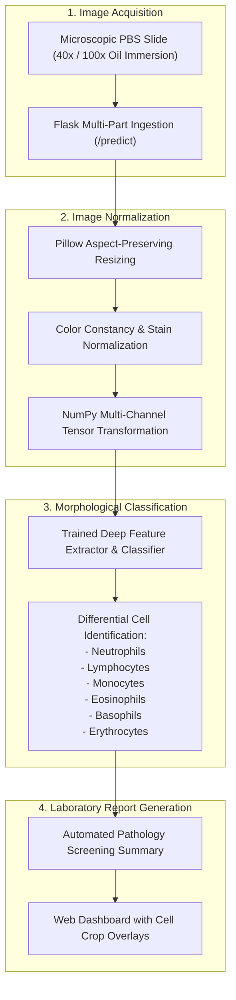

# HematoVision AI — Automated Hematological Blood Cell Classification

[](https://www.python.org/)
[](https://flask.palletsprojects.com/)
[](https://numpy.org/)
[](https://python-pillow.org/)
[](https://opensource.org/licenses/MIT)

A computer-vision-assisted laboratory diagnostic tool built with **Python**, **Flask**, and **NumPy**. HematoVision automates the classification and differential counting of white blood cells (leukocytes), red blood cells (erythrocytes), and platelets from digitized microscopic peripheral blood smear (PBS) slides.

---

## 🏛️ Diagnostic Pipeline



---

## 🔬 Hematological Class Coverage

The vision pipeline accurately segments and categorizes major peripheral blood components:
- **Neutrophils**: Multi-lobed nucleus with pale cytoplasm (bacterial infection & inflammation marker).
- **Lymphocytes**: Large spherical nucleus with minimal cytoplasmic halo (viral response & adaptive immunity marker).
- **Monocytes**: Kidney-shaped or folded nucleus with agranular cytoplasm (chronic infection & phagocytosis).
- **Eosinophils**: Bilobed nucleus with bright orange-pink cytoplasmic granules (allergic reactions & parasitic infections).
- **Basophils**: Coarse, dark purple granules obscuring the nucleus (histamine release & hypersensitivity).
- **Erythrocytes & Platelets**: Size, shape (normocytic, microcytic), and central pallor analysis for anemia and thrombocytopenia screening.

---

## 📂 Repository Structure

```text
hemato-vision-ai-classify/
├── app.py                      # Flask web server & inference endpoint
├── generate_model.py           # Model definition & feature weight generator
├── requirements.txt            # Python dependencies (Flask, Pillow, NumPy, Werkzeug)
├── report.txt                  # Sample clinical validation log
├── static/                     # CSS styles, diagnostic badges, and uploaded previews
├── templates/                  # HTML5 diagnostic view templates
└── HematoVision_Project_PPT.pptx # Comprehensive clinical research presentation
```

---

## 🚀 Local Setup & Execution

### 1. Installation
```bash
git clone https://github.com/ak-bharadwaj/hemato-vision-ai-classify.git
cd hemato-vision-ai-classify

python -m venv venv
source venv/bin/activate  # On Windows: .\venv\Scripts\activate

pip install -r requirements.txt
```

### 2. Generate Model Artifacts (If not already present)
```bash
python generate_model.py
```

### 3. Start Flask Web Server
```bash
python app.py
```
Open [http://localhost:5000](http://localhost:5000) to upload peripheral blood smear images and view instant cell classification outputs.
